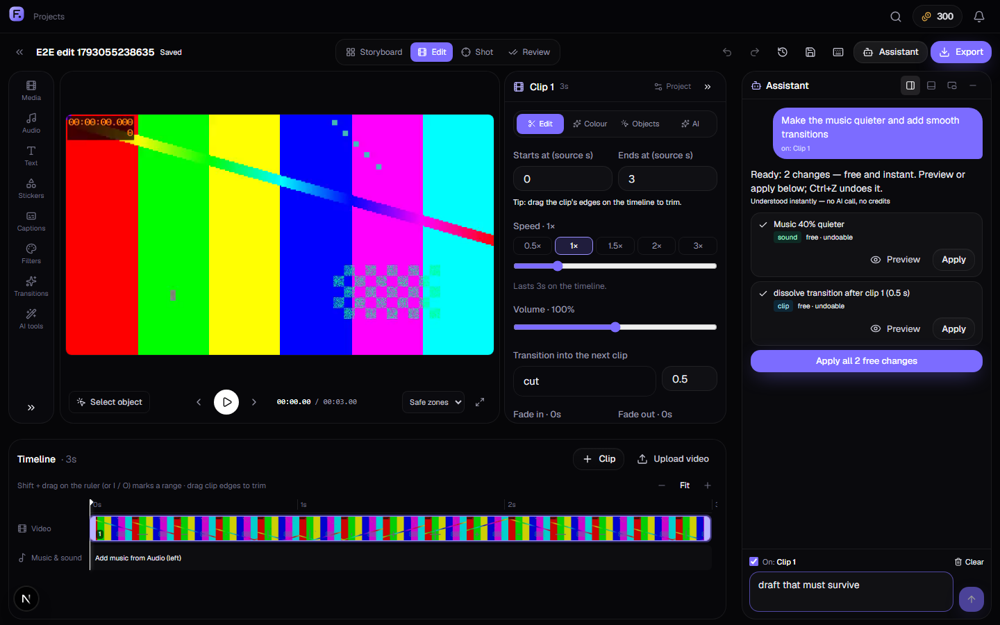
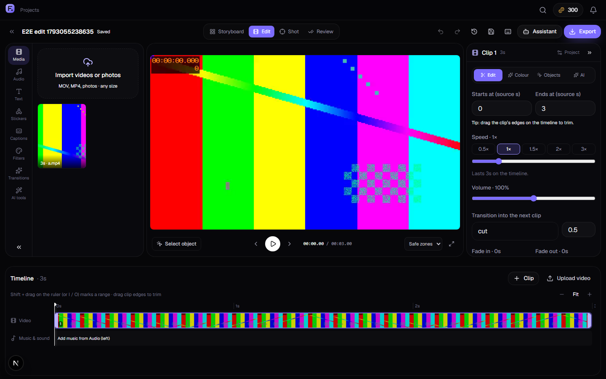
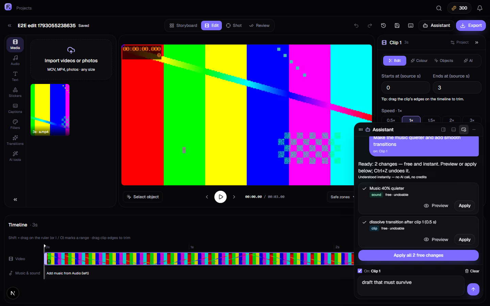
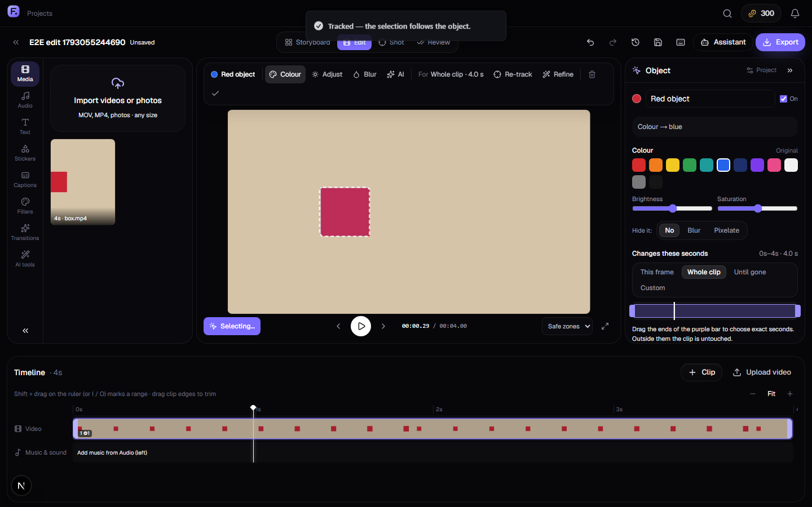
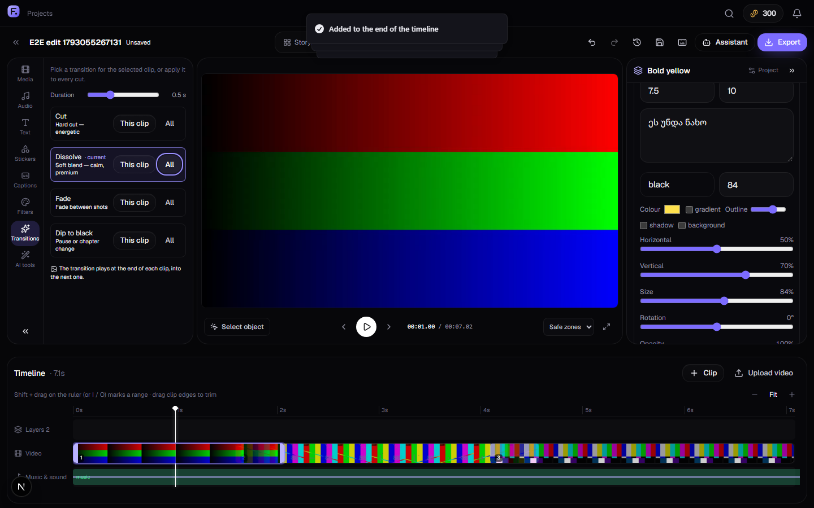
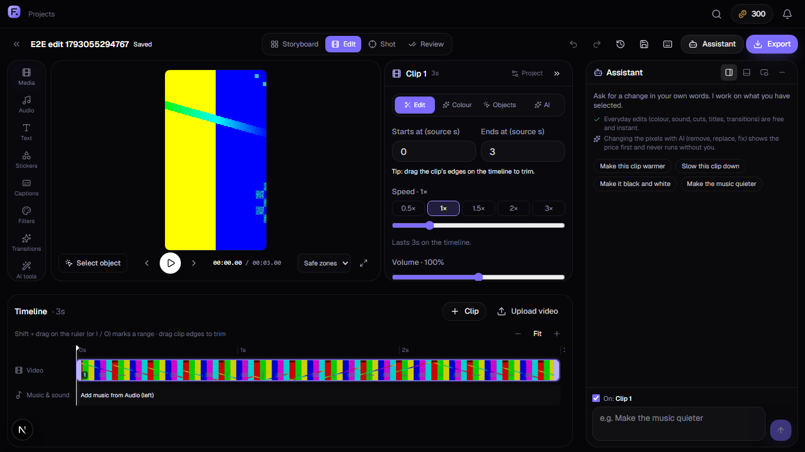
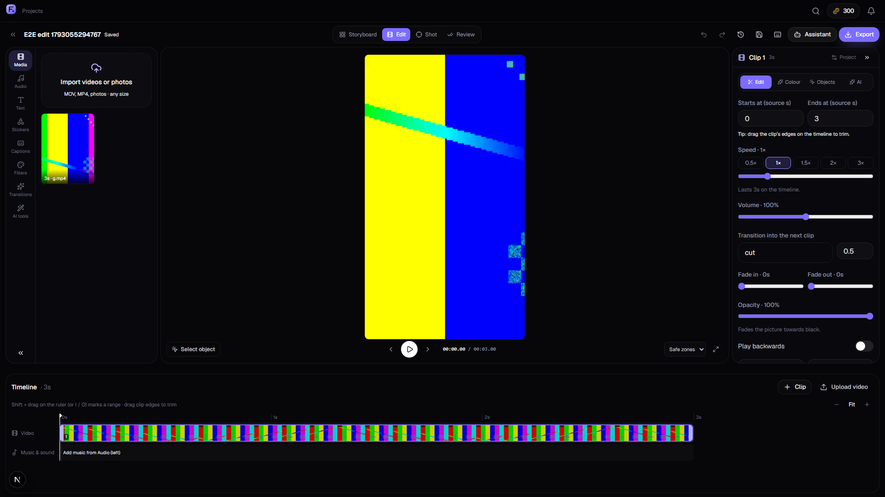
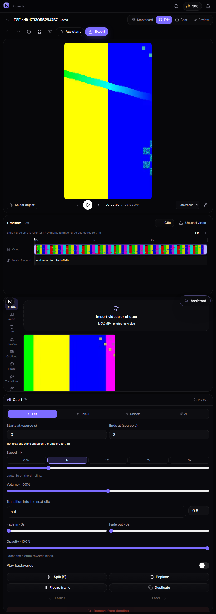
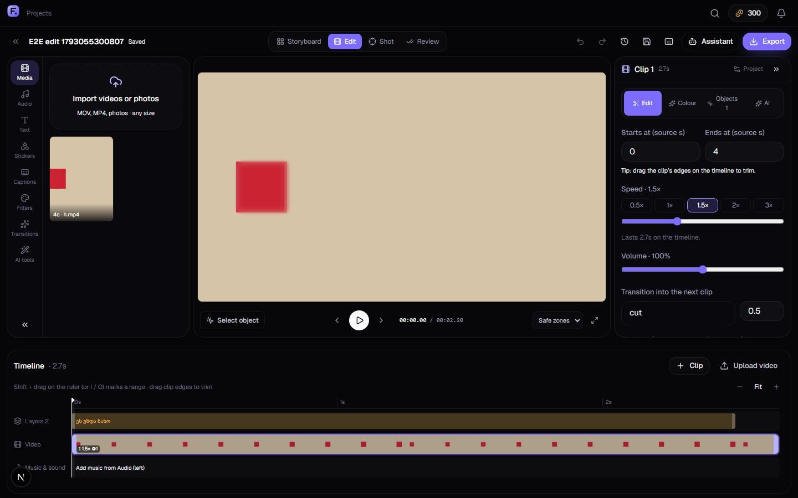
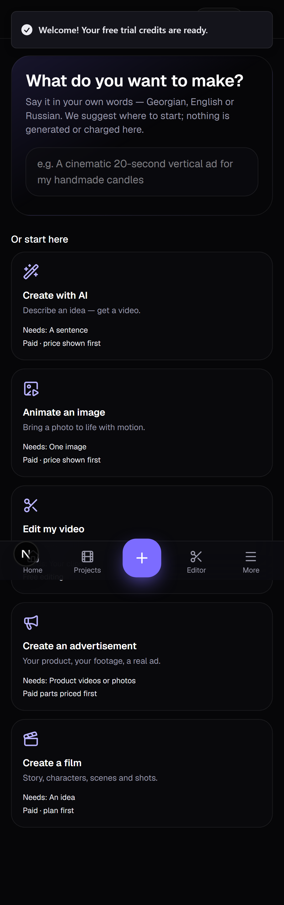

# Framecraft 5.0 — delivery report (2026-10-27)

One editor instead of several mini-apps: **Media → Preview → Timeline → Inspector → Assistant**, with
click-to-select objects that can follow motion, an assistant that docks anywhere and never loses the
conversation, and every paid action priced and confirmed first. Everything below was exercised in a
real browser on real video files; nothing paid was run.

## 1. What was wrong (full list with evidence: [AUDIT.md](AUDIT.md))

- The assistant was a fixed card over the preview; closing it **deleted the conversation and the draft**.
- Recolouring a moving object took five panels; the selected seconds were hidden; tracking failures were invisible.
- The colour preview **stretched** footage whose shape differed from the frame (preview ≠ export).
- **"Regenerate this shot with AI" spent credits without showing a price.**
- Revisiting the editor could show an **old cached timeline** that autosave would then write over newer work.
- Two text systems, two overlay systems, captions in three places; seven fixed inspector tabs.
- Your own footage could not be AI-edited (only generated "shots" could).

## 2. Competitor patterns used ([COMPETITORS.md](COMPETITORS.md), sources included)

Premiere's click-to-select object mask and forward/backward tracking · Resolve's +/− refinement and
"window + qualifier" colour isolation · Kling's auto-select-then-brush · invideo's "agent edits are
ordinary timeline edits" and plan-and-price-before-generation · Descript/invideo's docked co-editor ·
CapCut's contextual properties · Canva's edge-drag trim · LTX/OpenArt's simple storyboard first ·
Artlist's Auto vs Advanced model choice · Runway's visible edit window.

## 3. How people use it now

**Start.** *New video* opens a hub: type the idea in any of the three languages ("cinematic 20-second ad
for my candles") and Framecraft suggests the right start (*Advertisement · vertical · 20 s · cinematic*)
— or pick one of five cards: Create with AI · Animate an image · Edit my video · Create an
advertisement · Create a film. Nothing is generated or charged on that page.

**Edit.** The editor fills the screen: tool rail (Media, Audio, Text, Stickers, Captions, Filters,
Transitions, AI tools) · preview · properties of whatever is selected · full-width timeline. Panels
resize and collapse and are remembered. Clips trim by dragging their edges; Shift-drag on the ruler
(or I / O) marks "this part", which can be cut out with the gap closed (ripple).

**Change one object.** *Select object* (V) → click it → it is outlined and a toolbar appears above the
picture: **Colour · Adjust · Blur/Pixelate · AI · For: This frame / Whole clip / Until it disappears /
Custom · Track · Refine**. Choosing an effect for more than a moment tracks the object automatically
(free). Unsure frames are marked red on the clip; drag the outline there to correct, and tracking
continues from that frame. Shift-click adds a part, Alt-click removes one.

**Ask.** The assistant (Ctrl+J) docks right, bottom or floats; it knows the selected clip, object and
range ("make *this* darker"). Everyday requests are understood instantly on the device (no AI call, no
credits) and come back as **Preview / Keep / Cancel** changes; anything that changes pixels with AI
shows *what changes, what stays, model and price* and runs only after confirmation.

**Review.** AI results wait in a bar above the editor; *Compare* opens before/after (wipe or side by
side, scrubbed together) with Accept / Reject — without leaving the timeline.

## 4. What works in reality (verified)

| Area | Evidence |
|---|---|
| Task A — assistant collapses, gives the space back, keeps conversation + draft through every dock and a reload | Playwright `editor-5.spec.ts` › A; screenshots A1–A3 |
| Task B — click a moving red box, colour → blue, auto-track (incl. growth), export: box blue at 0.4/2/3.4 s, wall untouched | Playwright › B (exported pixels), server `object-edit.test.ts` (4 tests); screenshot B1 |
| Task C — AI fix of part of a clip: selection + seconds → dialog with *what changes / what stays / ≈ 272 credits* | Checked in the browser on own footage (clip became a shot automatically); **not generated** (paid) |
| Task D — 3 clips imported, reordered, trimmed by edge-drag, title, music, dissolves, exported MP4 with the expected length and audio | Playwright › D; screenshot D1 |
| Task E — Animate an image: image first, motion presets, model explained, price shown; Generate disabled until an image is added | Checked in the browser; **not generated** (paid) |
| Task F — Ad Studio: ads open on the storyboard (cards show the real frames), edit workspace, export path unchanged | Checked in the browser (read-only on an existing ad); server suite green |
| Task G — 1366, 1920, tablet 820: no sideways scroll, preview ≥ usable size, panels never overlap, assistant fits | Playwright › G; screenshots G-* |
| Task H — speed change, blurred object, title, assistant hidden, workspace switch, reload: all saved, versions kept | Playwright › H; screenshot H |
| Instant assistant (EN / KA / RU), ripple delete, object maths, smart select, intent hub | `packages/shared` tests (40) |

Test totals at delivery: shared 40 ✓ · server 147 ✓ (1 skipped manual) · Playwright 10 ✓ (5 skipped
by design: they need test-fixture mode and would otherwise spend real credits) · typecheck and lint clean.

## 5. Code map (new or rebuilt)

- `packages/shared/src/objects.ts` — object edits (selection, time scope, effects), transforms, colour function (incl. colourising grey/black objects), track merge.
- `packages/shared/src/segment.ts` — click-to-select (minimax geodesic in CIELAB + edges, automatic edge threshold, marching-squares outline).
- `packages/shared/src/quick.ts` · `edit.ts` — instant assistant and the new plan operations (object, look, volume, cut range…), `rippleDelete`.
- `packages/shared/src/intent.ts` — "what do you want to make" suggestion.
- `apps/server/src/media/object-fx.ts` — export of object edits (per-frame mask video + FFmpeg compositing); `tracker.ts` — scale search, reliability span, flat-patch guard.
- `apps/server/src/editing/versions.ts` — `ensureClipShot` (own footage → shot); routes `POST /api/projects/:id/shots/from-clip`, `GET /api/shots/:id/regenerate/estimate`.
- `apps/web/src/app/app/editor/[id]/page.tsx` — the workspace; `components/editor/{preview,inspector,assistant,object-tool,storyboard,review,editor-dialogs}.tsx`; `lib/{editor-ui,assistant,object-ui,plan-describe,shot-context}.ts`.
- `apps/web/src/components/editor/grade-canvas.tsx` — WebGL preview now crops exactly like the export and draws object effects.
- `apps/web/src/app/app/new/page.tsx` — creation hub; `composer.tsx` — *Animate an image* mode.

## 6. Still incomplete (honest)

- **Selection is colour/edge based, not a segmentation model.** Excellent for objects that differ from their surroundings (clothes, products, signs); busy textures need Refine (Shift/Alt-click, edge slider). A SAM-style model can plug into the same place later (it needs a model download or a paid API — not done without approval).
- **Tracking follows position and size**, not rotation or perspective; the outline shape does not deform. Recolour stays precise anyway because only the object's colour inside the moving window changes.
- Not built: timeline multi-select, speed ramps, keyframe curves for object effects, GIF stickers, a sound-effects library, solo/lock for the video lane, layer grouping.
- Assistant conversations are stored in the browser (per project), not synced between devices.
- Blur, pixelate and feathering in the *preview* are close approximations; colour is exact (same LUT as export).
- Headless browsers without WebGL2 show a note instead of the colour preview (the export is unaffected).

## 7. What needs paid AI

Generating videos/images/voice/music; AI edits of footage (remove, replace, fix, restyle, relight,
background, reframe/outpaint, camera remix); regenerating a shot; AI planning of complex assistant
requests (Claude — free to the user, paid by the platform). Everything else — editing, colour, object
recolour/adjust/blur, tracking, beat detection, captions styling, export — is free and local.

## 8. Provider limits that shape the UX

- Runway Aleph accepts **no mask**: Framecraft composites the result back so pixels outside the selection stay exact; inside, the model is asked to keep everything else but cannot guarantee identical pixels (said in the dialog).
- AI edit windows are limited per request (the dialog shows the seconds actually sent, with context).
- Video models speak English/Chinese only; Georgian/Russian speech comes from the voice-over (ElevenLabs).

## 9. Screenshots

